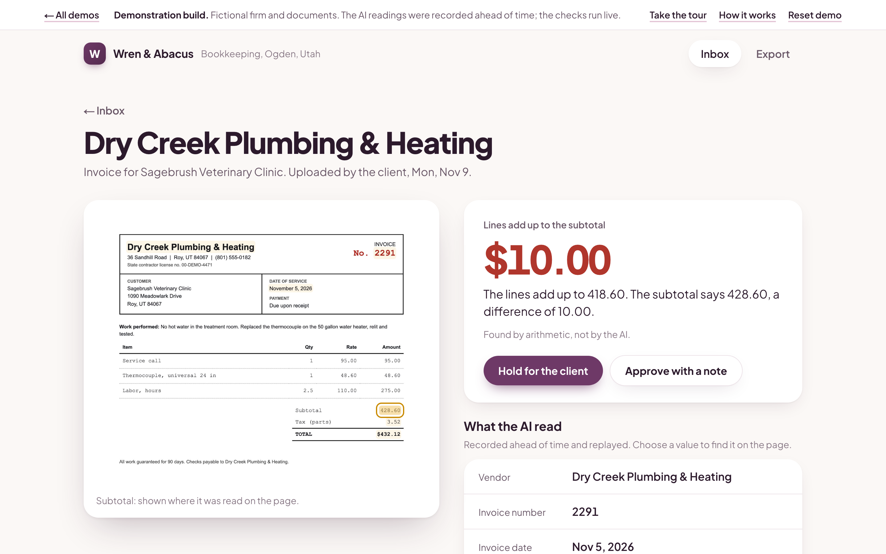
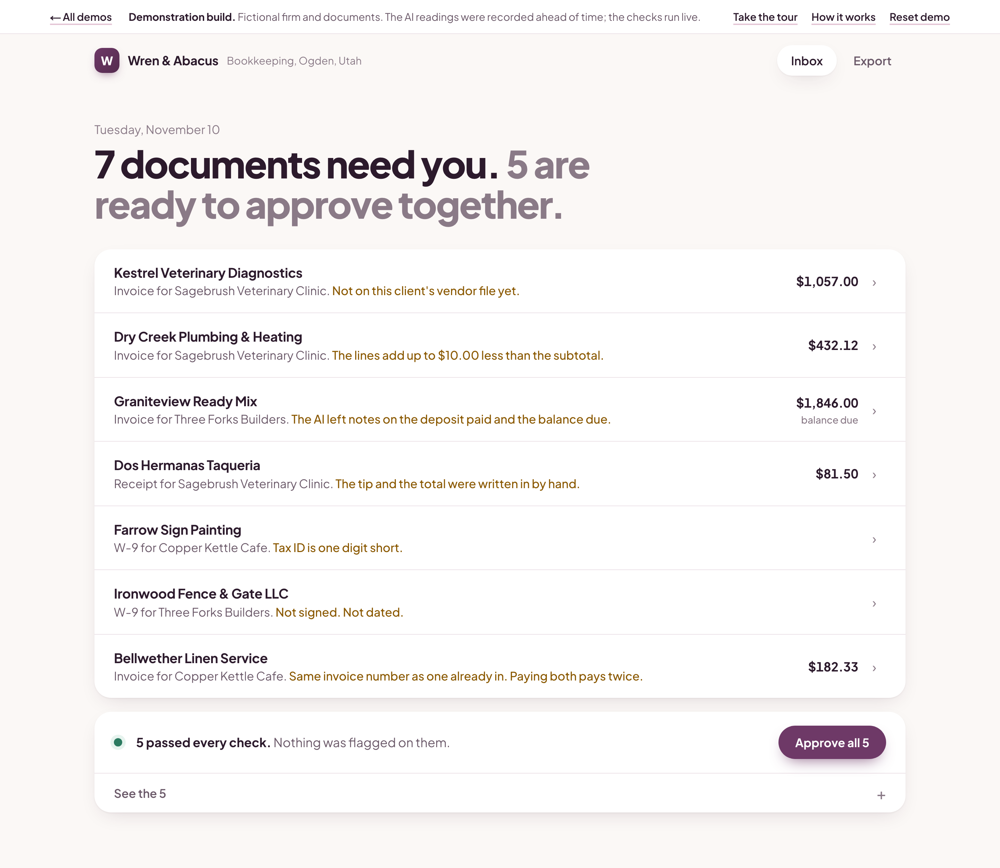
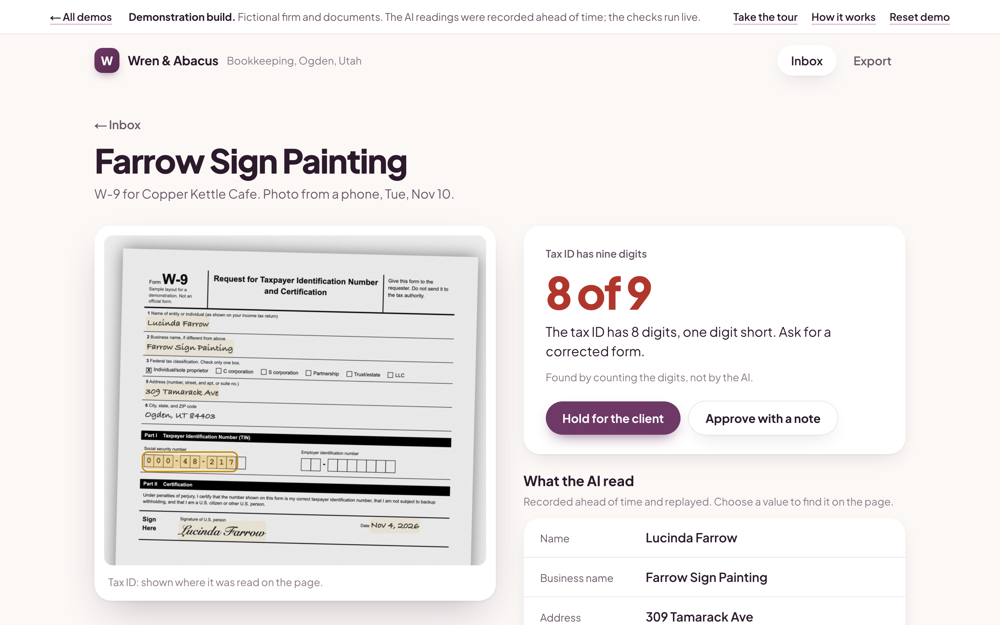
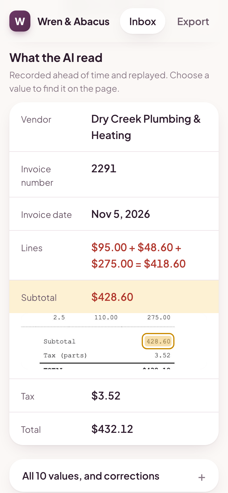
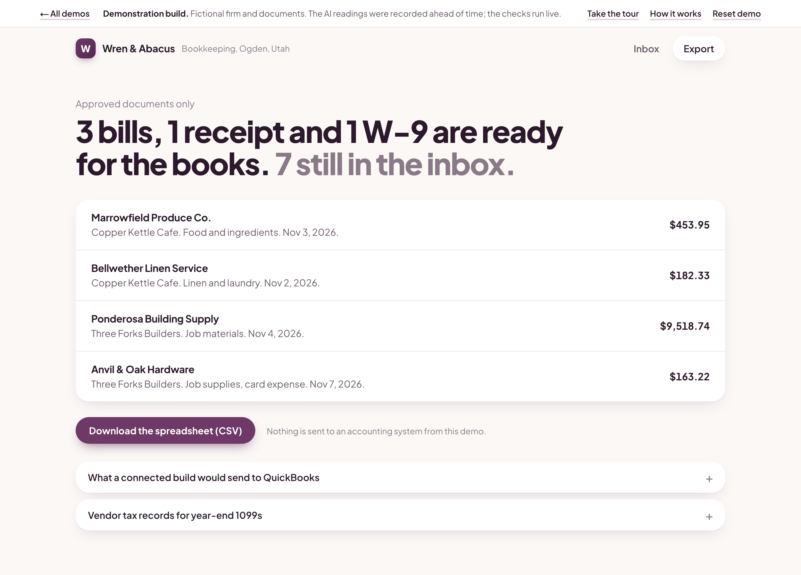

# Document AI extractor

Invoices, receipts and W-9s are read by AI, checked by arithmetic, and held for a person whenever something does not add up. Every value shows where on the page it came from.

> **Demo project.** This is a demonstration build by ChopMedia, not client work. Wren & Abacus Bookkeeping is a fictional firm. Its clients, the vendors, the tax ID numbers and every document are invented. The AI readings were recorded ahead of time and are replayed; the demo does not call an AI model while you use it, and nothing is sent anywhere.



**Live demo:** https://chopmedia-document-ai.vercel.app

## The problem

A small bookkeeping or accounting firm receives its clients' paperwork in every form there is: a clean invoice by email, a scan with a note in pen, a phone photo of a lunch receipt, a W-9 filled in by hand. Someone types each one into the accounting system. It is slow, and the mistakes are the expensive kind: a bill paid twice because the vendor sent a second notice, a subtotal the vendor added up wrong, a tax form with a digit missing that nobody notices until January.

AI can now read these pages well. The harder question is whether you can trust what it read without checking every page yourself, which would save nothing.

## What it does

- **Reads each document into the fields the books need.** Vendor, number, dates, line items, tax and total for invoices and receipts. Name, classification, tax ID and signature for W-9s.
- **Shows its work.** Choose any value and it lights up on the page where it was read. On a phone, a close-up of that part of the page appears right under the value.
- **Checks the reading with plain rules, not more AI.** Do quantity and price multiply out, do the lines add up to the subtotal, does subtotal plus tax equal the total, has this invoice number come in before, is the vendor on the client's file, does the tax ID have nine digits, is the form signed and dated.
- **Sorts the inbox by what needs a person.** One list of what is held, each with its reason in one line. Documents that pass everything are folded into one line and approved together in one click.
- **Puts one thing in front.** A document opens on the check that failed, as one figure and one sentence, beside the page. Every other value, every check and the history are a click away.
- **Keeps the person in charge.** Correct a value and the checks run again on the spot. Approving over a failed check needs a note saying why, holding a document for the client needs a note saying what to fix, and each document keeps a history of what was changed.
- **Exports only what was approved**, as a spreadsheet and as the request that would post each bill to the accounting system.

## Try it

The demo opens on a welcome page with today's numbers from your own copy of the inbox. **Take the tour** at the top walks through the next three steps in about a minute. Or click through yourself:

1. Open the inbox and the **plumber's invoice**. It opens on the failed check: the plumber's own lines add up to $10 less than the subtotal printed on the invoice, and the subtotal is already lit on the page. Choose any other value to find it too.
2. Open the **handwritten W-9**, a phone photo taken at an angle. The tax ID is one digit short, and it was caught.
3. Go back to the inbox and press **Approve all 5** on the clean ones. The export opens with the spreadsheet, and what would be sent to the accounting system is one click further.

**Reset demo** in the top bar puts everything back.



| A handwritten W-9, photographed | The same screen on a phone |
| --- | --- |
|  |  |



## What is recorded and what is real

**Recorded: the AI reading.** Each sample page was shown as an image to Claude, an AI model made by Anthropic, and what it read was saved: the values, and its notes where it was unsure how to treat something. The demo replays those saved readings. They were not tidied up afterwards. There are no confidence percentages on screen because the model did not give any, and none were invented. Replaying is what lets the demo run for free with no API key, and it is why you cannot upload your own documents here.

**Recorded: where each value sits on the page.** The sample pages were drawn by a script (`scripts/make-samples.mjs`), which also saved the position of every word. The highlight finds a value among those words. In a real build those positions come from the text-recognition step that runs on each incoming page.

**Real: everything after the reading.** The checks, corrections, approval rules, duplicate detection, vendor file, history and export all run live on your own private copy of the sample data.

**Stock: the photos.** The welcome page uses free photos from Unsplash (ids MhqUBTxQ3Hw, -Ym_TFojbQ8, UOalOTfpzlE, jsx4qvopjG4, xcvXS6wDCAY). The people in them are not staff or clients, and the page says so. The working screens have no photos.

## How it would plug into a real business

- **A way in for documents.** A shared mailbox, a scanner folder, or an upload page for clients. The demo starts with twelve documents already in the inbox.
- **A live AI reading** of each page as it arrives, set up and tested on the firm's own kinds of documents before anyone relies on it.
- **The accounting system.** The export page shows the request a QuickBooks Online connection would make for each approved bill. A real build sends it, using the vendor and account ids from the client's own books, and writes back what was posted.
- **The firm's own rules.** Which checks hold a document, which vendors are on file, what may be approved in bulk and by whom. Each check is one short function.
- **Staff sign-in and care with tax IDs.** The demo has no accounts because every visitor gets a private copy. A real build has sign-in and roles, and stores tax IDs encrypted with access recorded.

## What this demo is not

- It is not a measure of accuracy. Twelve sample pages drawn for a demo say nothing about how a model does on your documents. The way to find out is to run a batch of your real ones through it, and that is the first step of a real project.
- It does not give tax or accounting advice. The category on each bill is a suggestion for a bookkeeper to accept or change.
- It is not connected to QuickBooks or any other system, and it is not affiliated with one.
- There are no usage numbers, clients or testimonials, because it is a demonstration.

## Tech stack and architecture

Next.js 16 (App Router, React 19, TypeScript), Tailwind CSS 4, Drizzle ORM on Postgres, Zod, Vitest.

```
scripts/make-samples.mjs  draws the sample pages and saves each word's position
public/samples/           the page images
src/
  app/                    pages: welcome (/), inbox, review (/documents/[id]), export, how the demo works
  components/review.tsx   the review screen: page, the failed check, values, highlights, live checks
  components/tour.tsx     the guided tour across pages
  data/
    recordings.ts         what the AI read from each sample, saved
    words/                word positions for each page
  lib/
    checks.ts             every check, as plain functions
    locate.ts             finds a value's place on the page
    assess.ts             decides whether a document needs a person
    flag.ts               the one line and the one figure a person is shown first
    export.ts             the spreadsheet and the accounting request
  server/
    workflow.ts           every state change: correct, approve, hold for the client, reopen, add vendor
    actions.ts            thin server actions over the workflow
    queries.ts            what each screen reads
  db/                     schema, seed data, per-visitor sandboxes
```

Decisions worth knowing about:

- **The AI reads, rules decide.** Whether a document is held is never the model's call. It is decided by checks a bookkeeper can read, which run the same way on the model's values and on a person's corrections.
- **The same check code runs in the browser and on the server.** The screen reruns the checks as you type. The server runs them again before accepting an approval, so the rule about needing a note cannot be skipped.
- **Money is handled in whole cents**, never as fractions, so sums compare exactly.
- **The spreadsheet is safe to open.** Values that a spreadsheet program would treat as a formula are neutralized on export.
- **Tax IDs are masked** to the last four digits wherever they are listed, and W-9s are left out of the spreadsheet.
- **The recordings are tested against the pages.** A test confirms that every value the AI read can be found among the words on its page, so a highlight cannot point at nothing.
- **Every visitor gets their own sandbox.** A cookie names a private copy of the sample data, created on first visit and deleted after 48 hours.
- **No paid services and no keys.** Locally the app runs on an embedded Postgres (PGlite) stored in `.data/`. With `DATABASE_URL` set it uses a normal Postgres server.

## Run it locally

Needs Node.js 20.9 or newer.

```bash
npm install
npm run dev
```

Open http://localhost:3000. The database is created and filled with sample data on first visit. No settings are required.

```bash
npm test            # unit and workflow tests
npm run typecheck
npm run lint
npm run db:reset    # delete the local database and start fresh
```

To use a Postgres server instead of the embedded database, set `DATABASE_URL` to its connection string and run `npm run db:migrate`.

To redraw the sample pages, run `node scripts/make-samples.mjs` (needs Google Chrome). The saved readings in `src/data/recordings.ts` belong to the pages as drawn, so a changed page needs a new reading.

---

Built by ChopMedia. Contact Hayden Huelskamp at chopscales@gmail.com, or on [LinkedIn](https://www.linkedin.com/in/hayden-huelskamp-547a86302/).
